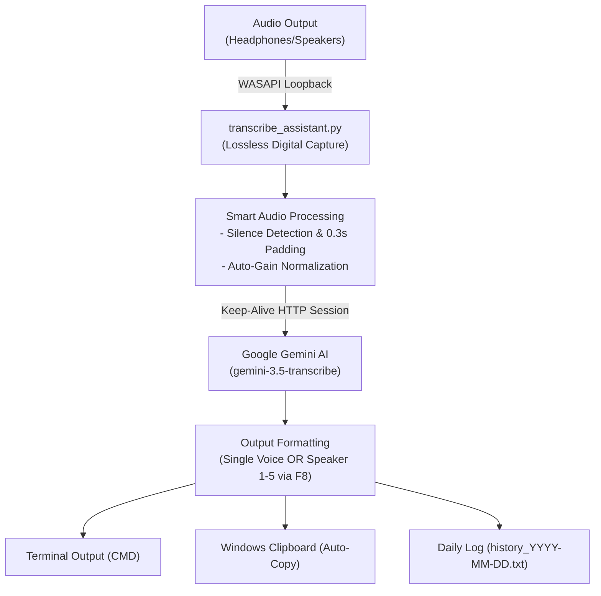

# 🎙️ Playback Audio Transcription Assistant (Windows)

An automated, lossless Windows audio transcription assistant powered by **Google Gemini AI**. Captures digital audio directly from your active headphones/speakers (*WASAPI Loopback*) and transcribes speech from **any website, video, or desktop software** with strict full-verbatim accuracy, speaker diarization (multi-speaker detection), and multi-language support.

---

## ✨ Key Features

- 🎧 **Universal Digital Audio Capture (Zero Noise)**:
  - Uses Windows WASAPI Loopback to record audio straight from your active output device (Speakers / Headphones).
  - Works with headphones plugged in—completely immune to background room noise.
  - Captures audio from **any source**: Web browsers (DataPlus, YouTube, Coursera, Loom), desktop media players, conferencing apps (Zoom, Teams, Google Meet), etc.
- 👥 **Speaker Diarization (Multi-Speaker Support up to 5 Speakers)**:
  - Toggle between **Single Voice Mode** and **Multi-Speaker Diarization** on the fly via hotkey `[ F8 ]`.
  - Automatically identifies and distinguishes different speakers, outputting structured labels (`Speaker 1: ...`, `Speaker 2: ...`, up to `Speaker 5`).
  - Supports 2-line diarized outputs for Asian scripts (Line 1: Native script, Line 2: Latin Romaji/Pinyin/Romanization per speaker).
- 🔊 **Auto-Gain & Smart Silence Trimming**:
  - Automatically boosts low-volume headphone playback up to optimal peak levels without digital distortion.
  - Detects pure silence and cancels API calls to save quota.
  - Intelligently trims dead silence at start/end of recording with 0.3s safety padding to ensure no words are clipped.
- ⚡ **Persistent HTTP Session Pooling**:
  - Leverages persistent connection pooling (`requests.Session`) to eliminate TLS handshake latency on repeated transcriptions.
- 📜 **Daily History Logging (`history_YYYY-MM-DD.txt`)**:
  - Automatically logs every transcription to a daily file (`history_YYYY-MM-DD.txt`), making it easy to recover past transcriptions.
- 🤖 **Gemini 3.5 Speech-to-Text Engine**:
  - Leverages Google's state-of-the-art models (`gemini-3.5-transcribe` with auto-fallback to `gemini-3.5-flash`).
  - Strict **Full Verbatim** enforcement: preserves filler words, natural hesitations (*um, uh, er, ano, eto, lah, kan, etc.*), and precise punctuation.
- 🌐 **Multi-Language Support (8 Languages Built-in)**:
  - 🇯🇵 **Japanese (`ja`)**: 2 Lines (Line 1: Kanji/Kana verbatim; Line 2: Latin Romaji reading).
  - 🇨🇳 **Mandarin Chinese (`zh`)**: 2 Lines (Line 1: Simplified Hanzi; Line 2: Pinyin with tone marks).
  - 🇰🇷 **Korean (`ko`)**: 2 Lines (Line 1: Hangul script; Line 2: Latin Romanization).
  - 🇹🇭 **Thai (`th`)**: 2 Lines (Line 1: Thai script with pauses; Line 2: RTGS Romanization).
  - 🇲🇾 **Malaysian Malay (`ms`)**: Full verbatim with colloquial particles (*lah, kan, tu, dll.*).
  - 🇮🇩 **Indonesian (`id`)**: Full verbatim with natural filler words (*eh, aa, anu, ya, dll.*).
  - 🇬🇧 **English (`en`)**: Full verbatim preserving stutters and pauses (*like, you know, um, uh*).
  - 🇻🇳 **Vietnamese (`vi`)**: Full verbatim in standard Quốc ngữ script with complete tone marks and diacritics.
- 🔄 **Smart Multi-API Key Failover**:
  - Pool multiple Gemini API keys in `config.json`.
  - If Key #1 hits rate limits or quota exhaustion (*HTTP 429 Too Many Requests*), the assistant automatically switches to Key #2 without interrupting or losing the recorded audio.
- ⌨️ **Global Hotkeys**:
  - `[ F9 ]`: Toggle recording (Start record -> plays audio beep -> Stop record -> Transcribe).
  - `[ F10 ]`: Instantly cycle through available languages on the fly.
  - `[ F8 ]`: Toggle Multi-Speaker Diarization (`Speaker 1 - 5`) on/off.
- 📋 **Flexible Output Modes**:
  - Formatted output printed clearly in the CMD terminal for manual review & copying.
  - Automatically copied to the Windows Clipboard for instant pasting.
  - Optional `"auto_paste"` toggle (disabled by default for QA review control).

---

## 🛠️ Architecture Overview



---

## 🚀 Quick Start

### 1. Prerequisites
- Windows 10 or Windows 11
- Python 3.10+ installed ([python.org](https://www.python.org/downloads/))

### 2. Installation
Clone this repository and install the required dependencies:
```bash
git clone https://github.com/your-username/automation-transcription.git
cd automation-transcription
pip install -r requirements.txt
```

### 3. Configuration
Copy `config.example.json` to `config.json` and insert your Gemini API Key(s):
```json
{
    "api_keys": [
        "YOUR_PRIMARY_GEMINI_API_KEY",
        "YOUR_SECONDARY_BACKUP_API_KEY"
    ],
    "language": "ja",
    "hotkey": "f9",
    "switch_hotkey": "f10",
    "diarization_hotkey": "f8",
    "diarization": false,
    "auto_paste": false,
    "save_history": true
}
```
> [!TIP]
> You can obtain Gemini API keys for free from [Google AI Studio](https://aistudio.google.com/).

### 4. Running the Assistant
Simply run the batch launcher:
```bash
RUN_ASSISTANT.bat
```
or run directly via terminal:
```bash
python transcribe_assistant.py
```

---

## 🎮 How to Use

1. **Start the Assistant**: Run `RUN_ASSISTANT.bat`. A terminal window will open showing active API keys, language, and speaker mode.
2. **Select Language**: Press **`F10`** anytime to cycle to your target language (Japanese, Malay, Thai, English, etc.).
3. **Toggle Multi-Speaker**: Press **`F8`** if the audio contains a conversation between multiple people (identifies up to 5 speakers with `Speaker 1:`, `Speaker 2:`, etc.). Press again to switch back to single voice.
4. **Play Audio**: Start playing the audio segment in your browser, media player, or app.
5. **Record**:
   - Press **`F9`** to start recording (a beep will sound).
   - Once the audio finishes playing, press **`F9`** again to stop.
6. **Review & Copy**:
   - The verbatim transcription will immediately appear formatted inside the CMD console.
   - It is pre-copied to your clipboard, ready for manual `Ctrl + V` pasting.
   - It is also automatically logged into `history_YYYY-MM-DD.txt` for that day.

---

## ⚙️ Configuration Reference

| Parameter | Type | Default | Description |
| :--- | :---: | :---: | :--- |
| `api_keys` | `array` | `[]` | List of Gemini API keys for automatic failover rotation. |
| `language` | `string` | `"ja"` | Default language code (`ja`, `ms`, `id`, `en`, `zh`, `ko`, `th`, `vi`). |
| `hotkey` | `string` | `"f9"` | Global shortcut key to start/stop recording. |
| `switch_hotkey` | `string` | `"f10"` | Global shortcut key to cycle languages. |
| `diarization_hotkey` | `string` | `"f8"` | Global shortcut key to toggle multi-speaker diarization. |
| `diarization` | `boolean` | `false` | When `true`, separates speech by `Speaker 1` to `Speaker 5`. |
| `auto_paste` | `boolean` | `false` | When `true`, automatically sends `Ctrl+V` to the focused window. |
| `save_history` | `boolean` | `true` | When `true`, appends results to `history_YYYY-MM-DD.txt`. |

---

## 📄 License
This project is open-source and available under the [MIT License](LICENSE).
